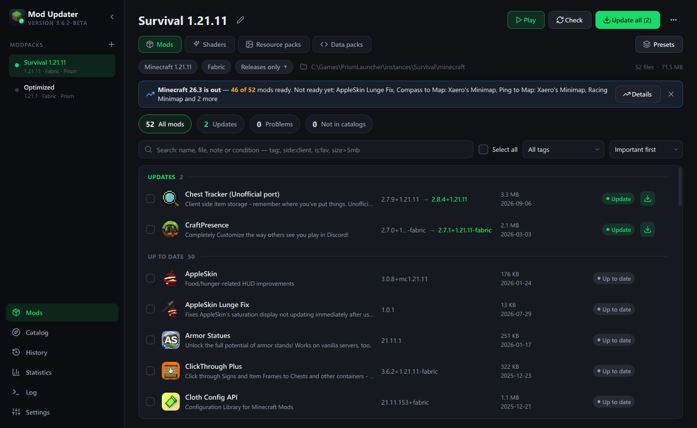
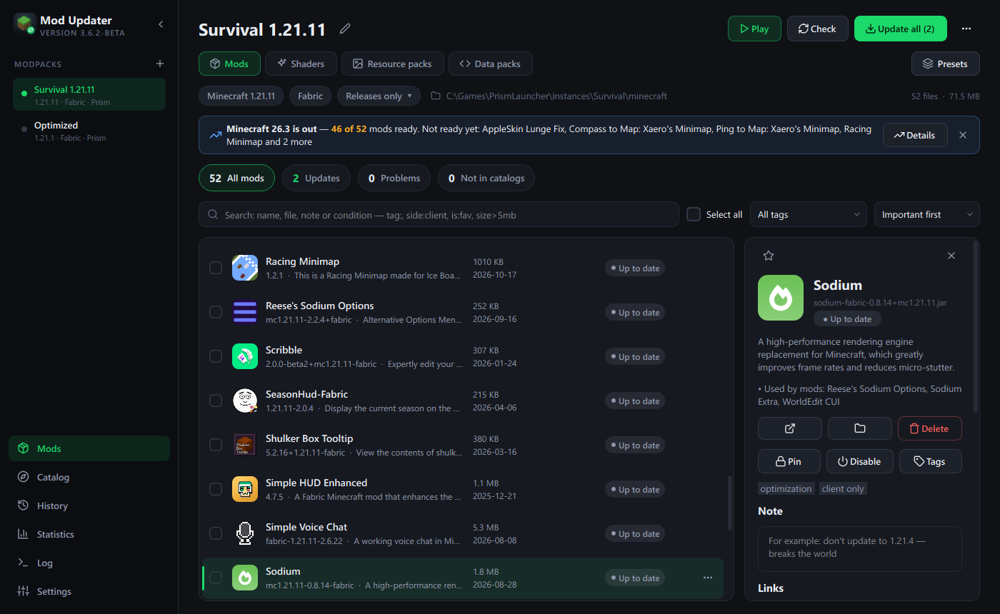
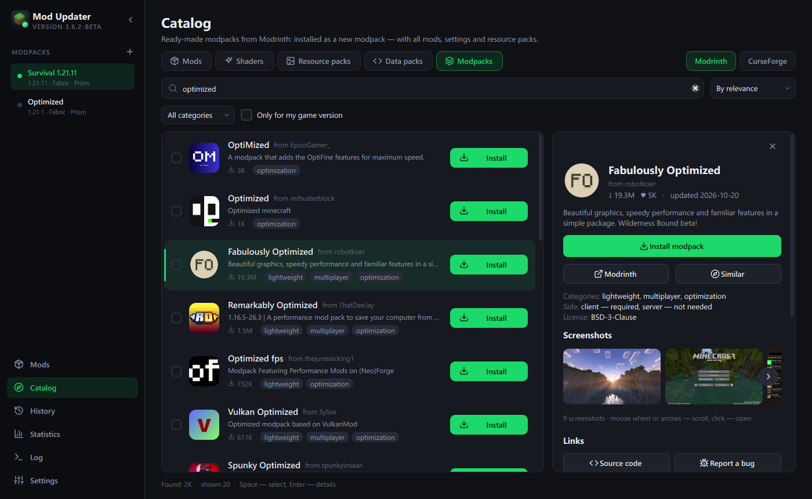
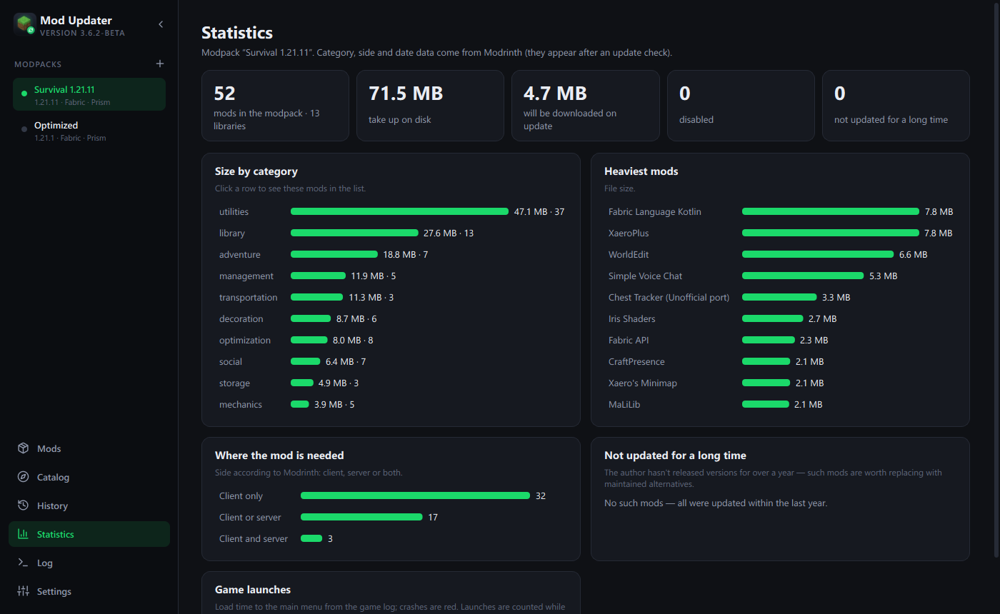
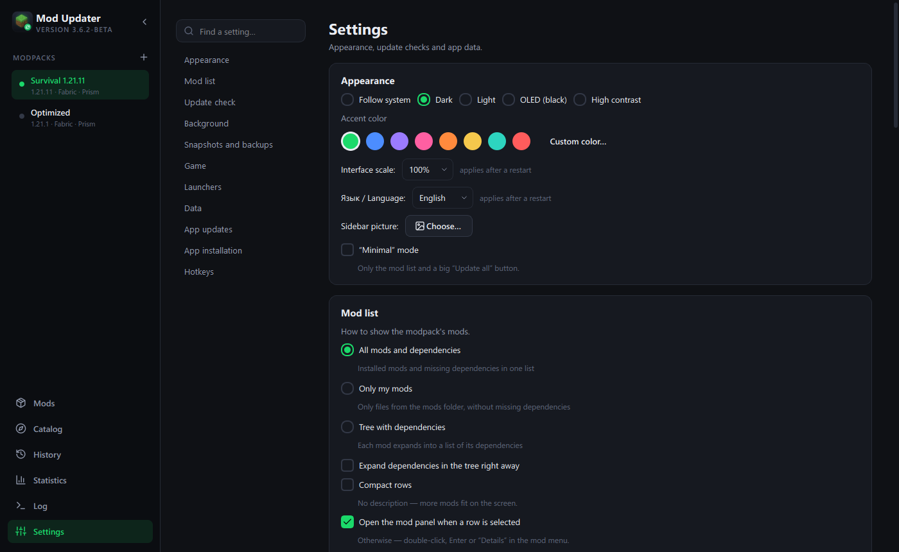

# Minecraft Mod Updater

[](https://github.com/TheMrEvgen/MinecraftModUpdater/releases/latest)
[](https://github.com/TheMrEvgen/MinecraftModUpdater/releases)
[](https://github.com/TheMrEvgen/MinecraftModUpdater/actions/workflows/tests.yml)
[](LICENSE)

A Windows desktop app that keeps Minecraft mods up to date. It finds the modpacks of your launchers, recognizes
installed mods on **Modrinth** and **CurseForge**, installs updates together with required dependencies — and lets you
roll back any change. English and Russian interface.



- **Updates you can trust** — every change is recorded and can be undone; a snapshot of the modpack is made before big
  updates; “What's new” shows changelogs before updating; fresh releases can be held back for a few days.
- **Works with your launcher** — Prism Launcher, MultiMC, Modrinth App, CurseForge, Legacy Launcher and the official
  launcher are found automatically. For Prism and the official launcher (Fabric/Quilt) the app can even update the
  loader and the game version.
- **Catalog** — mods, shaders, resource packs, data packs and ready-made modpacks from Modrinth and CurseForge,
  installed with dependencies in one click. Installed modpacks update to new versions and keep the mods you added.
- **When the game crashes** — crash report analysis (including wrong Java and out of memory, fixed in one click),
  a hint which mod update started the crashes, and an automatic search for the problematic mod by elimination.
- **Safety** — mods are scanned for known malware (fractureiser), mods from GitHub Releases update like the rest,
  and a server pack (.zip) leaves out client-only mods.
- **Background** — tray icon, background update checks for all modpacks with Windows notifications, app self-update.

| | |
|---|---|
|  |  |
|  |  |

---

## По-русски

Программа для Windows, которая следит за модами Minecraft: находит обновления на [Modrinth](https://modrinth.com)
и [CurseForge](https://www.curseforge.com/minecraft), ставит их вместе с зависимостями и позволяет откатить любое
изменение. Язык интерфейса — в «Настройки → Оформление → Язык / Language».

## Возможности

**Сборки**
- Сборки из Prism Launcher, MultiMC, Modrinth App, CurseForge, Legacy Launcher и официального лаунчера находятся автоматически,
  любую папку игры или сервера можно добавить вручную.
- Моды, шейдеры и ресурспаки — на отдельных вкладках.
- Группы сборок, клонирование, сравнение двух сборок.

**Обновления**
- Проверка по хэшам файлов: программа точно знает, какая версия установлена.
- Каналы «Только релизы», «Релизы и беты», «Все».
- Недостающие обязательные зависимости ставятся сами; зависимости другого загрузчика не навязываются.
- «Что нового» перед обновлением: списки изменений всех промежуточных версий.
- Закрепление версии мода, чтобы его не трогало «Обновить все».
- Проверка готовности к новой версии Minecraft и переход сборки на неё.

**Безопасность**
- Каждая операция записывается и откатывается со страницы «История».
- Снимки всей сборки перед большими изменениями (жёсткие ссылки — почти не занимают места).
- Пока игра запущена, изменения модов заблокированы.
- Проверка целостности: битые архивы и остатки прерванных загрузок.
- Проверка модов на вирусы: признаки червя fractureiser и следы заражения компьютера.

**Игра**
- Кнопка «Играть»: запуск сборки через её лаунчер (или своя команда). Перед запуском — проверка Java и памяти
  с исправлением прямо в настройках лаунчера.
- После вылета — разбор краш-репорта: какие моды упоминаются в ошибке; «не та Java» и «не хватило памяти»
  распознаются отдельно.
- Поиск проблемного мода перебором, вручную или полностью автоматически: программа сама запускает игру,
  ждёт меню или вылета и выключает половину модов, пока не найдёт виновника.

**Каталог Modrinth и CurseForge**
- Поиск с фильтрами по категориям и версиям, страница проекта со скриншотами и версиями, массовая установка.
- Готовые сборки: установка одной кнопкой — новой сборкой в Prism Launcher или в папку; обновление до новой
  версии сборки с сохранением ваших модов и настроек.
- Моды, которых нет на Modrinth, опознаются на CurseForge по отпечатку файла и обновляются так же.
  Если автор запретил скачивание сторонними программами, программа откроет страницу файла на сайте.
- Моды, которые выходят только на GitHub, обновляются из выпусков (Releases) репозитория.

**Удобство**
- Список модов: плоский, «только мои», дерево зависимостей; выбор колонок, компактные строки.
- Поиск с условиями: `tag:оптимизация`, `side:client`, `is:fav`, `status:update`, `size>5mb`, `age>1y`, `-tag:библиотека`.
- Избранное, заметки, свои метки, наборы модов (быстро включить/выключить группу модов), Ctrl+Z.
- Палитра команд Ctrl+K, свои горячие клавиши.
- Темы: системная, тёмная, светлая, OLED, высококонтрастная; цвет акцента, масштаб, картинка в боковой панели.
- Импорт и экспорт `.mrpack`, обмен списком модов строкой или файлом, синхронизация по ссылке, JSON для сервера,
  сборка для сервера (.zip) без клиентских модов.
- Установка из самой программы: ярлыки, пункт в «Установке и удалении программ», открытие `.mrpack`
  двойным щелчком и ссылки `modupdater://`.
- Автообновление: программа сама находит новые версии на GitHub, скачивает с проверкой контрольной суммы и
  перезапускается.
- Работа в фоне: значок в трее, автозапуск с Windows, проверка обновлений во всех сборках и уведомления Windows.

## Download / Скачать

**[ModUpdater.exe — latest release](https://github.com/TheMrEvgen/MinecraftModUpdater/releases/latest)** (Windows 10/11).

Code signing: Free code signing provided by [SignPath.io](https://about.signpath.io/), certificate by
[SignPath Foundation](https://signpath.org/) — *application in progress; until it is approved, release builds are
unsigned.* See the [code signing policy](CODE_SIGNING.md) and the [privacy policy](PRIVACY.md).

## Запуск

Скачайте `ModUpdater.exe` со страницы [выпусков](https://github.com/TheMrEvgen/MinecraftModUpdater/releases/latest) — это один файл, установка не обязательна.
При первом запуске можно установить её в профиль пользователя: «Настройки → Установка программы»
(права администратора не нужны).

Данные программы (настройки, кэш, логи): `%LOCALAPPDATA%\MinecraftModUpdater`.

### Из исходников

Нужен Python 3.10 или новее (рекомендуется 3.12).

```bat
pip install -r requirements.txt
python main.py
```

### Консольный режим

Удобен для серверов и планировщика задач:

```bat
python main.py --check --profile "Моя сборка"
python main.py --update-all --game-dir D:\server --game-version 1.21.11 --loader fabric
python main.py --rollback --game-dir D:\server
python main.py --help
```

## Разработка

```bat
pip install -r requirements-dev.txt
python -m pytest -q                       :: юнит-тесты
python tools/ui_checks/run.py             :: проверка интерфейса на песочницах (нужен интернет, ~3 минуты)
python tools/i18n_check.py                :: все ли строки переведены на английский
build.bat                                 :: тесты и сборка .exe в dist/
```

**CurseForge.** Нужен ключ API (console.curseforge.com). В выпусках он встраивается из секрета GitHub
`CURSEFORGE_API_KEY`, локально — переменная окружения `CURSEFORGE_API_KEY` или файл `_build_secrets.py`
(в git не хранится). Без ключа программа работает только с Modrinth.

**Перевод.** Строки интерфейса пишутся по-русски и оборачиваются в `tr("…")`, английский перевод лежит в
`locales/en.json` (ключ — русская строка). `tools/i18n_wrap.py` размечает новые строки автоматически,
`tools/i18n_check.py` показывает непереведённые.

**Проверка интерфейса.** `tools/ui_checks` запускает настоящее окно программы (без показа на экране) на
песочницах с модами с Modrinth и проходит по основным сценариям: обновление и откат, импорт, каталог, инструменты,
запуск игры с автоматическим поиском проблемного мода. Снимки экрана и логи сохраняются в рабочую папку.

Что изменилось в версиях — в [CHANGELOG.md](CHANGELOG.md).

## Лицензия / License

[MIT](LICENSE) © TheMrEvgen. [Политика конфиденциальности / Privacy policy](PRIVACY.md) ·
[Подпись кода / Code signing policy](CODE_SIGNING.md).
